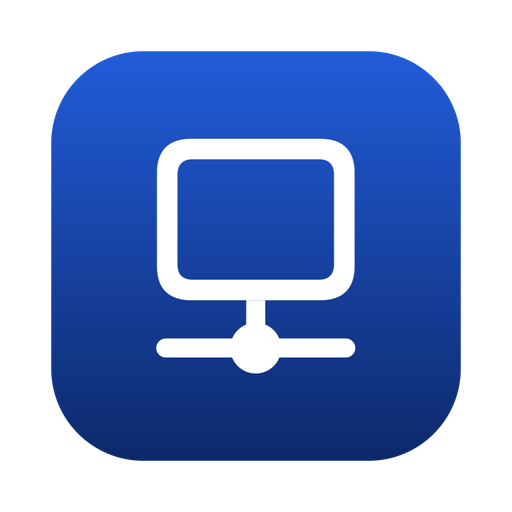
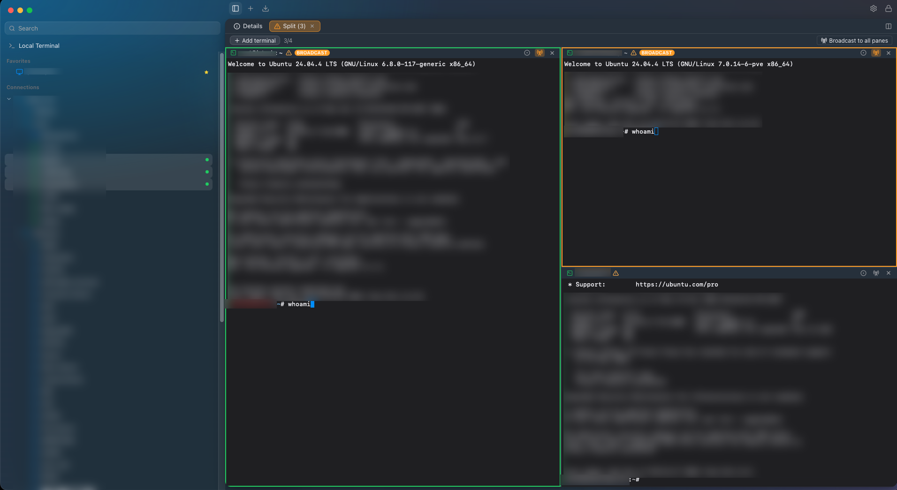
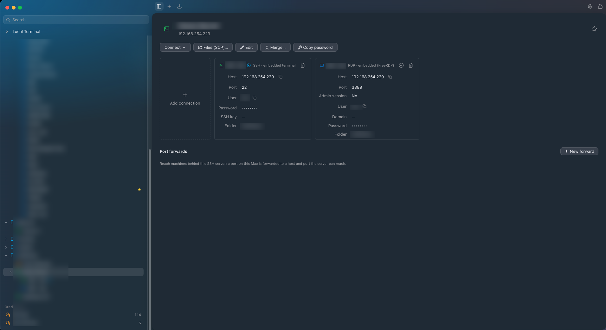
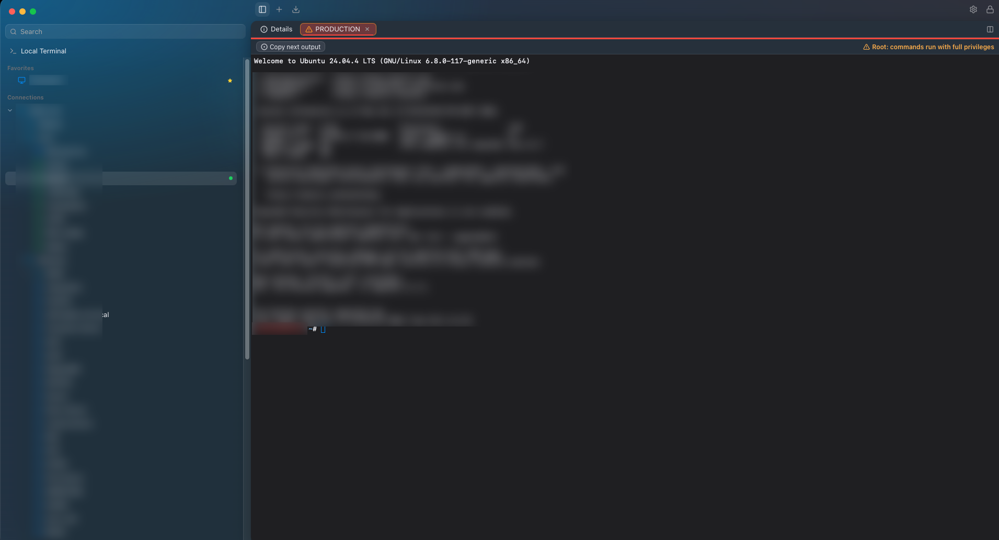
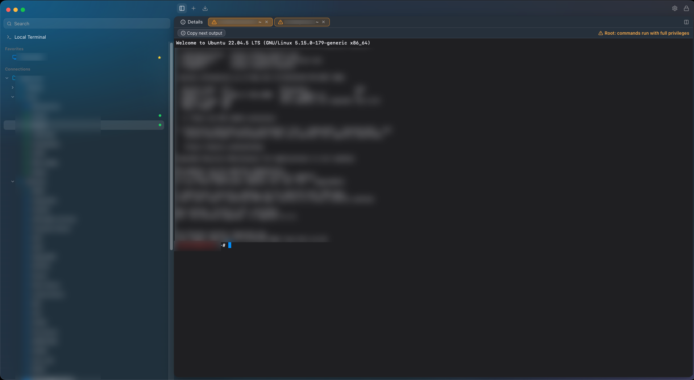
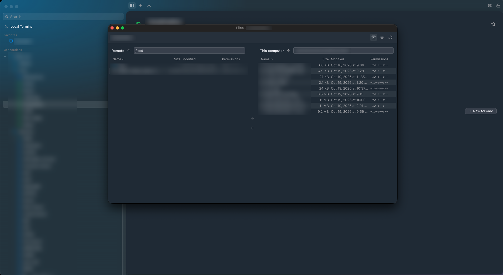

<div align="center">



# RemoteDesktop

### ⚡ One app for **RDP · SSH · Web · MikroTik** on macOS, Windows and Linux

*A fast, lightweight alternative to Devolutions Remote Desktop Manager.*<br>
*Opens instantly · everything behind one master password.*

[](https://github.com/LovaszCC/RemoteDesktop/releases/latest)
[](LICENSE)
<br>


<br>
<br>
<br>
[](https://ko-fi.com/R7Z128YA8L)
<br>
<br>
<br>
**[⬇️ Download](https://github.com/LovaszCC/RemoteDesktop/releases/latest)** ·
**[✨ Features](#-what-it-does)** ·
**[🔐 Security](#-security)** ·
**[🛠 Build](#-build-from-source)**

🇬🇧 English · 🇭🇺 Magyar — switch in *Settings → Language*

</div>

---

If you manage lots of servers, you probably have RDP connections in one app, SSH sessions in another, the
router's web UI bookmarked somewhere, and passwords in a fourth place. RemoteDesktop puts all of them in
one window: a sidebar with your folders and connections, and tabs for the sessions you open. Everything
sensitive is locked behind one master password.

<p align="center">
  
</p>

> [!NOTE]
> **New in 1.6.5:** RemoteDesktop now runs on Windows and Linux too. If you used the earlier macOS app,
> just update — your connections, passwords and settings come with you
> ([how it works](#-coming-from-the-old-macos-app)).

## 🚀 Install

Grab the file for your system from the
[latest release](https://github.com/LovaszCC/RemoteDesktop/releases/latest).

**🍎 macOS (Apple Silicon)** — open the `.dmg` and drag **RemoteDesktop** into *Applications*. The app isn't
notarized by Apple, so the first time macOS will stop it: open it once, then go to *System Settings →
Privacy & Security* and click **Open Anyway**.

**🪟 Windows** — run the `-setup.exe`. It installs just for you, no admin rights needed. The installer
isn't signed, so if SmartScreen says *"Windows protected your PC"*, click **More info → Run anyway**.

**🐧 Linux** — pick whichever suits your distro:

| | |
|---|---|
| **AppImage** | make it executable (`chmod +x …AppImage`) and run it |
| **.deb** (Debian, Ubuntu) | `sudo apt install ./RemoteDesktop_…_linux_amd64.deb` |
| **.rpm** (Fedora, openSUSE) | `sudo dnf install ./RemoteDesktop_…_linux_x86_64.rpm` |

It needs a reasonably recent distro (Ubuntu 22.04, Debian 12, Fedora 36 or newer).

### 🔄 Updates

The app keeps itself up to date. It checks once a day (or whenever you click *Check for Updates…*), and
when there's a new version it downloads it, installs it and restarts. No installer to click through.

If you share your database file between computers, keep the app on all of them up to date: once a newer
version has opened the file, an older one won't touch it and asks you to update first.

Want new features before they're released? Install the
[beta-latest](https://github.com/LovaszCC/RemoteDesktop/releases/tag/beta-latest) build by hand once; from
then on it updates itself to each newer beta (not to stable releases; install a stable release by hand to
go back). Betas are less tested, and please don't use one with a database you share with people on the
stable version: once a beta has opened it, their app will ask them to update first.

### 🔁 Coming from the old macOS app

Versions up to 1.6.4 were a macOS-only app. 1.6.5 replaces it:

1. In the old app choose *Check for Updates…* → *Download*.
2. Drag the new **RemoteDesktop** over the old one in *Applications*. This is the only time you have to do
   it by hand; later updates install themselves.
3. Start it. Your database, remembered master password and settings are picked up automatically, and a
   short welcome message confirms it.

If you use Windows App password autofill, macOS will ask for the *Accessibility* permission again, because
it treats the new app as a different program. (This also happens after later updates, since the builds
aren't signed by Apple.)

Taking a copy of `~/Library/Application Support/RemoteDesktop/connections.sqlite` before the switch never
hurts.

---

## ✨ What it does

| | |
|:-:|---|
| 🖥️ **RDP** | Opens in a tab inside the app, or in the system's own client (Windows App, Remote Desktop Connection, Remmina). Copy and paste works both ways, files too. |
| 💻 **SSH** | A terminal tab inside the app, or your favourite terminal app. Your `~/.ssh/config` just works, and saved passwords are filled in for you. |
| 🌐 **Web** | Opens the admin page in your browser and puts the password on the clipboard, ready to paste. Scheme, port and path are separate fields, and pasting a whole URL fills them in for you. |
| 📶 **MikroTik** | Over SSH or straight into WinBox, already logged in. |

And a few things that make everyday work nicer:

- **🧩 One entry per machine.** A server can have several connections under one name: SSH and RDP, the
  web admin page next to WinBox, or two SSH logins (say `root` and `deploy`), each with its own login or
  shared credential. Pick one as the default: a double-click or *Connect* opens that one. The details page
  has a button for each connection plus a *Connect ▾* menu with all of them, and *Merge…* folds entries
  you made for the same machine into one.
- **🔑 Shared credentials.** Save a login once and use it on as many connections as you like. Change the
  password in one place and every connection follows.
- **🗂️ Folders, favourites and search.** Drag and drop to organise, colour folders, and find anything by
  name, host, user or notes as you type.
- **🎨 Coloured tabs.** Give production servers a red colour and you'll always know where you are typing.
- **🟢 See what's open.** A green dot in the sidebar marks every entry with a live session, and several
  tabs of the same server line up next to each other (`web01`, `web01 (2)`). If you'd rather jump straight
  back into a session, set *Settings → Sidebar* so a click on an open entry brings its tab forward instead
  of its details. When a server is open in several tabs, its details page lists them so you can jump to
  any of them.
- **🔎 Open from the system search.** Turn on *Settings → Sidebar → Show entries in system search* and
  type an entry's name into Spotlight, the Start menu or your desktop's search: opening it starts the app
  (or brings it forward) and connects, just like a double-click. See [System search](#-system-search).
- **⌨️ ISO keyboards on the Mac.** On a Hungarian (or other ISO) Mac keyboard, Windows sessions usually
  mix up the key left of `1` and the key next to left Shift (`0` types `í`). The embedded RDP swaps them
  back automatically when it finds an ISO keyboard; turn it on or off in *Settings → General → Embedded
  RDP*. Applies to sessions opened afterwards.
- **📡 Split view with broadcast.** Open up to four terminals side by side, and type into all of them at
  once — handy for configuring several switches the same way.
- **📋 Copy next output.** Press the shortcut, run a command, and its output lands on your clipboard as
  clean text. Works even after `sudo -i` or on RouterOS.
- **📁 File browser.** Copy files and folders between your computer and a server over SSH, with drag and
  drop.
- **🔀 Port forwards.** Save SSH tunnels with an entry and start or stop them with one click. With several
  SSH connections you pick which one each tunnel runs through.
- **⚠️ Root warning.** A tab shows a warning sign while you're logged in as root.
- **☁️ Your data, your place.** Everything lives in a single database file. Put it in iCloud Drive,
  OneDrive or Dropbox and use it from several computers (just not from two at the same time).
- **🌍 English and Hungarian**, switchable without restarting.

### 📸 A quick look

| | |
|:-:|:-:|
|  |  |
| One entry, several connections | A production server, logged in as root |
|  |  |
| Green dots show what's open | Copy files over SSH |

### ⌨️ Keyboard shortcuts

Every shortcut can be changed in *Settings → Keyboard Shortcuts*. The defaults:

| Action | macOS | Windows / Linux |
|---|:-:|:-:|
| Connect | Double-click / <kbd>⌘</kbd><kbd>↩</kbd> | Double-click / <kbd>Ctrl</kbd><kbd>Enter</kbd> |
| New RDP / SSH / web / MikroTik connection | <kbd>⌘N</kbd> / <kbd>⇧⌘N</kbd> / <kbd>⇧⌘B</kbd> / <kbd>⇧⌘M</kbd> | <kbd>Ctrl+Shift+N</kbd> / <kbd>S</kbd> / <kbd>B</kbd> / <kbd>M</kbd> |
| New folder / credential | <kbd>⌥⌘N</kbd> / <kbd>⌃⌘N</kbd> | <kbd>Ctrl+Shift+G</kbd> / <kbd>P</kbd> |
| New local terminal | <kbd>⌘T</kbd> | <kbd>Ctrl+Shift+H</kbd> |
| Import from RDM / WinBox | <kbd>⌘I</kbd> / <kbd>⇧⌘I</kbd> | <kbd>Ctrl+Shift+I</kbd> / <kbd>X</kbd> |
| Lock | <kbd>⌃⌘L</kbd> | <kbd>Ctrl+Shift+L</kbd> |
| Toggle sidebar | <kbd>⌃⌘S</kbd> | <kbd>Ctrl+Shift+E</kbd> |
| Close tab / reconnect | <kbd>⌘W</kbd> / <kbd>⌘R</kbd> | <kbd>Ctrl+Shift+W</kbd> / <kbd>R</kbd> |
| Next / previous tab | <kbd>⌃Tab</kbd> / <kbd>⌃⇧Tab</kbd> | <kbd>Ctrl+Tab</kbd> / <kbd>Ctrl+Shift+Tab</kbd> |
| Type the clipboard into an RDP session | <kbd>⇧⌘V</kbd> | <kbd>Ctrl+Shift+T</kbd> |
| Split terminal | <kbd>⌘D</kbd> | <kbd>Ctrl+Shift+D</kbd> |
| Broadcast to all panes | <kbd>⌥⌘I</kbd> | <kbd>Ctrl+Shift+A</kbd> |
| Clear terminal | <kbd>⌘K</kbd> | <kbd>Ctrl+Shift+K</kbd> |
| Copy next output | <kbd>⌥⌘C</kbd> | <kbd>Ctrl+Shift+O</kbd> |
| File browser | <kbd>⇧⌘F</kbd> | <kbd>Ctrl+Shift+F</kbd> |

Inside an RDP session on a Mac, <kbd>⌘C</kbd> / <kbd>⌘V</kbd> copy and paste like you'd expect, and
<kbd>⌘</kbd> on its own opens the Windows Start menu.

---

## 🔐 Security

Passwords and SSH key passphrases are stored encrypted (AES-256), with a key that comes from your master
password. Without it, the database file is useless to anyone who gets hold of it, so it's safe to keep in
the cloud.

- *Remember on this computer* keeps you unlocked using the system keychain, so you don't have to type the
  master password every time.
- Passwords you copy are hidden from clipboard managers and cleared after 30 seconds.
- Connection names and hosts are not encrypted, so search stays fast.

---

## 📥 Moving over from another app

**From Devolutions RDM:** in RDM choose *File → Export → Export all entries…* in **.rdm** format. To bring
the passwords along, tick *include credentials* and leave the export unencrypted. Then use *File → Import
from RDM…* here. Folders, connections and credentials all come across.

**From WinBox:** *File → Import from WinBox…* reads a WinBox address book (`.cdb`). You'll see a preview,
pick a folder, and your routers turn into MikroTik connections.

**From anything else (CSV):** *File → Import from CSV…* explains the columns and offers a sample file. Put
your servers in a spreadsheet with the columns `folder`, `name`, `host` and `type` (`rdp`, `ssh`, `web` or
`mikrotik`), save it as CSV (`;` or `,`, UTF-8) and choose it. Rows with the same name become one entry with
several connections. Logins and passwords aren't part of the file: set them afterwards for many entries at
once.

> [!WARNING]
> The RDM and WinBox export files contain your passwords in plain text. Delete them once the import is done.

---

## 🤝 Sharing entries with a colleague

*File → Export…* lets you tick the entries (or whole folders) and credentials to hand over, for example the
server list for a new colleague.

- **With a password** the file (`.rdexport`) is encrypted (AES-256-GCM) and carries the passwords too.
- **Without a password** the file is readable and carries no passwords at all, only hosts, users and names.
- An entry whose credential you didn't tick goes without it, so the colleague can link their own.
- SSH keys never leave your computer.

Your colleague opens it with *File → Import from RemoteDesktop export…*, types the password if there is one,
and picks what to bring in. For anything they already have, they choose **Overwrite** or **Keep both**.

---

## 🔎 System search

With *Settings → Sidebar → Show entries in system search* on, every entry gets a small launcher file named
after it, in a folder the app keeps for itself:

| | Folder | File |
|---|---|---|
| macOS | `~/Applications/RemoteDesktop Entries` | `Home Server.rdentry` (Spotlight) |
| Windows | Start menu → `RemoteDesktop Entries` | `Home Server.lnk` (Start search) |
| Linux | `~/.local/share/applications/remotedesktop-entries` | `Home Server.desktop` (desktop search, also in the app list) |

- The files follow your entries: a new, renamed or deleted entry changes its file, and a file you delete
  comes back. Same names get ` (2)`, ` (3)`…
- They carry only the entry's id: no host, user or password. If the database is locked, the entry opens
  after you unlock it.
- They belong to the database that's open. Switching databases swaps them.
- Turning the setting off deletes the folder. **Turn it off before uninstalling**, the uninstaller doesn't
  know about the folder.

---

## 🛠 Build from source

You'll need [rustup](https://rustup.rs), Node 26, pnpm 12, and CMake, Ninja and Perl (for the built-in
RDP engine). On Linux you'll also need the WebKitGTK development packages.

```sh
pnpm -C app/ui install
pnpm -C app/ui tauri dev        # run the app
cargo test --workspace          # Rust tests
pnpm -C app/ui test             # UI tests
scripts/build-macos.sh          # release build (also build-linux.sh, build-windows.ps1)
```

The first build takes a few extra minutes while it compiles FreeRDP and OpenSSL.

---

## 📜 License

MIT, see [LICENSE](LICENSE). It ships with FreeRDP and OpenSSL (Apache License 2.0) and the open-source
packages listed in `Cargo.lock` and `app/ui/pnpm-lock.yaml`.

<div align="center">
<br>

**Built with ❤️ for sysadmins who live in terminals.**

<sub>Rust · Tauri · FreeRDP · xterm.js · OpenSSL</sub>

</div>
